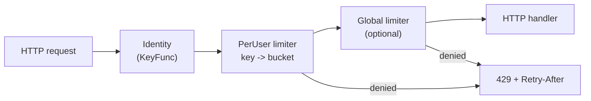

# token-bucket-rate-limiter

An in-process token bucket rate limiter for Go, with a per-user layer, an optional global limit, an HTTP middleware, and documentation of the concurrency and distributed-systems trade-offs behind each design choice.

The library is small (standard library only), and the repository is meant to be read: the code, the tests and the documents explain not only what the limiter does but why it is built this way and where it stops being the right tool.

```go
l, err := limiter.NewLimiter(limiter.Config{Rate: 10, Capacity: 100}) // 10/s sustained, bursts of 100
if err != nil {
    log.Fatal(err)
}
if l.Allow() {
    // handle the request
}
```

- [Why rate limiting exists](#why-rate-limiting-exists)
- [The token bucket mental model](#the-token-bucket-mental-model)
- [Architecture](#architecture)
- [Features](#features)
- [Example usage](#example-usage)
- [HTTP middleware](#http-middleware)
- [Per-user and global limiting](#per-user-and-global-limiting)
- [Configuration](#configuration)
- [Concurrency guarantees](#concurrency-guarantees)
- [Testing](#testing)
- [Benchmarks](#benchmarks)
- [Observability](#observability)
- [Distributed-system limitations](#distributed-system-limitations)
- [Production considerations](#production-considerations)
- [Project structure](#project-structure)
- [Design trade-offs](#design-trade-offs)
- [Future extensions](#future-extensions)

## Why rate limiting exists

A service has finite capacity, and some callers will send more than it can handle: through bugs (a retry loop with no backoff), misconfiguration, or malice (credential stuffing, scraping, floods). Without a limit, one caller's excess degrades service for everyone, and cascades to the databases and downstream services behind it.

A rate limiter bounds what any one caller, or the whole service, can consume:

- **Fairness**: one noisy client cannot starve the others.
- **Protection**: databases and dependencies see a bounded load.
- **Abuse resistance**: password guessing and scraping become slow.
- **Cost control**: metered downstream calls stay within budget.

The limiter answers one question quickly, many thousands of times per second: _may this request proceed now?_

## The token bucket mental model

```
        refill: Rate tokens per second
                  |
                  v
           +-------------+
           |   tokens    |   holds at most Capacity
           +------+------+
                  |
                  v   each request removes n tokens
        enough tokens?  yes -> allowed
                        no  -> rejected (or wait)
```

| Quantity       | Meaning                                                      |
| -------------- | ------------------------------------------------------------ |
| `Capacity`     | largest number of tokens the bucket holds; the maximum burst |
| `Rate`         | tokens added per second; the sustained throughput            |
| current tokens | request budget available right now                           |

With `Capacity = 100` and `Rate = 10`, a client can send 100 requests instantly, then 10 per second. If the bucket holds 73 tokens and one request arrives, 72 remain. If no requests arrive, tokens accumulate until the bucket reaches 100, and never beyond: `0 <= tokens <= Capacity` is the central invariant. Letting it exceed capacity would turn a long quiet period into an unbounded future burst, which is the thing the limiter exists to prevent.

The bucket is not refilled by a timer. Each call computes `elapsed x Rate`, adds it, clamps to capacity, then checks and consumes ("lazy refill"). Idle buckets cost nothing and there is no goroutine to manage.

This differs from "10 requests per second" implemented as a counter that resets every second, which cannot express bursts separately from rate and permits up to double the limit across a window boundary. Details, worked examples and comparisons with fixed window, sliding window and leaky bucket are in [docs/token-bucket.md](docs/token-bucket.md).

## Architecture



The flow:

1. **Identity.** A `KeyFunc` maps the request to a key: authenticated user, API key, or client address.
2. **Per-user limiter.** The key selects that client's bucket, created on first use.
3. **Global limiter.** If configured, the same request is also charged to a shared bucket.
4. The per-user and global charges are made **atomically**: both buckets are locked, both are checked, and tokens are taken from both or from neither. A request rejected by one layer never drains the other.
5. Allowed requests reach the handler; denied ones receive 429 with a `Retry-After` header.

The three layers are separate and usable on their own: `Limiter` (one bucket), `PerUser` (many buckets, optional global, lifecycle management), and `Middleware` (HTTP). See [docs/architecture.md](docs/architecture.md) for component diagrams, data structures, the synchronization model, error paths and numbered design decisions.

## Features

- Token bucket with lazy refill, fractional tokens and validated configuration.
- `Allow`, `AllowN`, and `Take` (which also returns a retry hint).
- `Wait` and `WaitN` with context cancellation, deadline fail-fast, and no goroutine leaks.
- Per-key limiting with isolation between keys.
- Optional global limit charged atomically with the per-key limit, without token leakage.
- Memory lifecycle for per-key state: lossless cleanup of idle keys, an optional hard cap, caller-owned cleanup goroutine.
- HTTP middleware with 429, `Retry-After`, and identity strategies for authenticated IDs, API keys, peer addresses (IPv6 handled per /64) and trusted-proxy `X-Forwarded-For`.
- Injectable clock for deterministic tests.
- Vendor-neutral `Observer` interface for metrics.
- Standard library only.

## Example usage

### Basic limiter and burst

```go
l, err := limiter.NewLimiter(limiter.Config{Rate: 5, Capacity: 10})
if err != nil {
    log.Fatal(err) // invalid configuration is reported at construction
}

l.Allow()   // one token
l.AllowN(3) // three tokens, all or nothing

d := l.Take(1)
if !d.Allowed {
    fmt.Println("retry in", d.RetryAfter)
}
```

### Waiting with a context

```go
ctx, cancel := context.WithTimeout(context.Background(), 2*time.Second)
defer cancel()

if err := l.Wait(ctx); err != nil {
    // context.Canceled, context.DeadlineExceeded (including the case where the
    // required wait is already longer than the deadline), or a validation error
    return err
}
```

`Wait` returns immediately, without sleeping, if the needed delay exceeds the context's deadline. It uses at most one timer per call and starts no goroutines.

### Runnable examples

| Command                        | Shows                                                        |
| ------------------------------ | ------------------------------------------------------------ |
| `go run ./examples/basic`      | creating a limiter, spending and refilling tokens, `AllowN`  |
| `go run ./examples/burst`      | burst capacity versus sustained rate                         |
| `go run ./examples/peruser`    | per-user isolation, global limit, cleanup                    |
| `go run ./examples/wait`       | `Wait` pacing, deadline fail-fast, cancellation              |
| `go run ./examples/http -demo` | HTTP middleware, 429, `Retry-After`, metrics, in one process |
| `go run ./examples/http`       | the same server on `:8080`, for use with `curl`              |

`make examples` runs all the self-terminating ones. Output of the burst example is timing dependent (about 10 of 200 sustained attempts succeed at 5/s over 2 s).

## HTTP middleware

```go
users, err := limiter.NewPerUser(limiter.PerUserConfig{
    Limit:    limiter.Config{Rate: 1, Capacity: 5},
    MaxUsers: 100_000,
})
if err != nil { log.Fatal(err) }

identity := limiter.FirstKey(
    limiter.KeyFromContextValue(userIDKey{}, "user:"), // set by your auth middleware
    limiter.KeyFromHeader("X-API-Key", "key:"),
    limiter.KeyFromRemoteAddr(),
)

go func() { _ = users.RunCleanup(ctx, time.Minute) }() // lifecycle is yours

http.Handle("/", limiter.Middleware(users, identity)(myHandler))
```

```
request -> KeyFunc -> PerUser.Take(key, 1) -+-> allowed -> handler
                 |                          +-> denied  -> 429 + Retry-After
                 +-> no identity -> 400
```

```
$ for i in $(seq 1 7); do curl -s -o /dev/null -w '%{http_code} ' localhost:8080/; done
200 200 200 200 200 429 429

$ curl -si localhost:8080/ | head -3
HTTP/1.1 429 Too Many Requests
Content-Type: text/plain; charset=utf-8
Retry-After: 1
```

**`Retry-After`** is whole seconds, rounded up, so a client that obeys it does not retry too early. It is a hint, not a reservation: another request may take the token first. It is omitted when no estimate exists. Clients should add jitter so that many of them told "retry in 1 second" do not return in lockstep.

**Identity matters more than the limiter.**

| Strategy                                     | Notes                                                                                                                                                                                                     |
| -------------------------------------------- | --------------------------------------------------------------------------------------------------------------------------------------------------------------------------------------------------------- |
| Authenticated user ID                        | Best. Requires authentication to run first.                                                                                                                                                               |
| API key                                      | Validate the key _before_ limiting on it, or clients can mint unlimited identities, each with a fresh bucket and a table entry.                                                                           |
| Peer address (`KeyFromRemoteAddr`)           | Cannot be spoofed by headers, but NAT, corporate networks, mobile carriers and proxies put many users behind one address; IPv6 gives one user a whole /64, so addresses are truncated to /64.             |
| `X-Forwarded-For` (`KeyFromForwardedFor(n)`) | The client controls the left side of the header. Only use it behind exactly `n` proxies you operate; it uses the `n`-th entry from the right and gives no identity if there are fewer. Never the default. |

See [docs/architecture.md](docs/architecture.md), section 8.

## Per-user and global limiting

```go
global, _ := limiter.NewLimiter(limiter.Config{Rate: 10_000, Capacity: 10_000})
users, _ := limiter.NewPerUser(limiter.PerUserConfig{
    Limit:  limiter.Config{Rate: 100, Capacity: 100},
    Global: global,
})

users.Allow("user-123")
```

Each key has an independent bucket: user A exhausting theirs does not affect user B, unless the shared global bucket is also empty.

**Why the composition is not simply `global.Allow() && user.Allow()`.** If the global check succeeds and the user check fails, a global token was spent on a rejected request. A single abusive user whose requests are all rejected would still drain the global budget and starve everyone else. Checking the user first leaks in the other direction. A refund has windows of spurious rejection. `PerUser` instead holds both buckets' locks, checks both, and only then consumes from both, so rejected requests are free for the layer that would have admitted them. Tests prove this in both directions and under concurrency ([docs/architecture.md](docs/architecture.md), section 6).

**Memory lifecycle.** With millions of distinct keys the table is the main memory cost.

- `Cleanup()` removes every bucket that has refilled to capacity. A full bucket is indistinguishable from a new one, so this never changes a later decision (a fixed idle timeout would, for slow refill rates). Retention is at most `Capacity / Rate` after the last request.
- `RunCleanup(ctx, interval)` runs `Cleanup` periodically; you start it in your own goroutine and it stops with the context. `PerUser` itself starts no goroutines.
- `MaxUsers` adds a hard cap. When full, new keys are rejected (existing keys keep working) rather than evicting active ones, because eviction would reset their budgets. The trade-off is that key flooding can lock out _new_ users until buckets refill.

## Configuration

```go
type Config struct {
    Rate     float64  // tokens per second; finite, > 0
    Capacity float64  // maximum tokens / burst; finite, >= 1
    Clock    Clock    // optional; nil means the system clock
    Observer Observer // optional; nil disables notifications
}
```

| Field                    | Constraint                      | Why                                                                         |
| ------------------------ | ------------------------------- | --------------------------------------------------------------------------- |
| `Rate`                   | finite and greater than zero    | zero or negative never refills; NaN and Inf make the arithmetic meaningless |
| `Capacity`               | finite and at least 1           | a capacity below 1 could never satisfy even a one-token request             |
| `PerUserConfig.MaxUsers` | not negative; 0 means unbounded |                                                                             |
| `RunCleanup` interval    | positive                        |                                                                             |

Validation happens in `NewLimiter` and `NewPerUser`, which return errors wrapping `ErrInvalidConfig` (check with `errors.Is`), so a bad configuration fails at startup. The bucket starts full.

## Concurrency guarantees

- All methods of `Limiter`, `PerUser` and `Counters` are safe for concurrent use.
- Refill, availability check, consumption and timestamp update are one atomic step under the bucket's mutex. The clock is read inside it, so timestamps are applied in order.
- Tokens are never double spent, never go negative, and never exceed capacity.
- `AllowN` is all-or-nothing; the two-layer charge is all-or-nothing across both layers.
- Lock order is table, then global limiter, then user limiter; no code path violates it, so it cannot deadlock.
- Observers run after locks are released.

Not guaranteed: ordering or fairness among concurrent callers, and in particular among `Wait` callers, which retry rather than queue.

Why each of these needs the lock, with examples of the wrong implementations and the bugs they produce, is in [docs/concurrency.md](docs/concurrency.md).

## Testing

```
go test ./...          # all tests
go test -race ./...    # under the race detector
go test -bench=. ./... # with benchmarks
make check             # gofmt, vet, test, test -race, benchmark smoke run
```

The suite is designed to demonstrate correctness, not only to cover lines:

- **Deterministic time.** An injected fake clock makes refill tests instant and exact.
- **Exact-answer concurrency tests.** With a frozen clock, 64 goroutines against 1,000 tokens must admit exactly 1,000. This catches double spends that the race detector cannot, since each access in such a bug is individually synchronized.
- **Model-based property test.** Random operation sequences are compared with an exact rational-arithmetic model; `0 <= tokens <= capacity` is checked after every step.
- **Lossless-cleanup test.** A swept and an unswept limiter must make identical decisions on the same workload.
- **Leak test.** Cancelled `Wait` calls leave no goroutines behind.

Statement coverage is reported by `make cover`; it says which code is never executed, not that the code is correct. See [docs/testing.md](docs/testing.md).

## Benchmarks

```
go test -run '^$' -bench . -benchmem ./limiter
```

| Benchmark                                   | Measures                                        |
| ------------------------------------------- | ----------------------------------------------- |
| `BenchmarkLimiter_Allow`                    | uncontended cost of one decision                |
| `BenchmarkLimiter_AllowParallel`            | all goroutines on one bucket (mutex contention) |
| `BenchmarkPerUser_AllowParallel`            | goroutines spread over many keys                |
| `BenchmarkPerUser_AllowParallel_HotKey`     | all goroutines on one key                       |
| `BenchmarkPerUser_AllowParallel_WithGlobal` | adds the shared global limiter                  |

No results are published here. They depend on hardware, core count and `GOMAXPROCS`, and a machine with few cores cannot show contention. Run them on the hardware that matters, use `-cpu` to vary parallelism, and repeat runs before comparing. The benchmarks also report allocations.

## Observability

The core package depends on no metrics library. `Config.Observer` and `PerUserConfig.Observer` receive `Allowed(n)`, `Rejected(n)` and `Waited(d, err)`; `PerUser.Len()` provides an active-keys gauge. Suggested metrics:

| Metric                             | Type      |
| ---------------------------------- | --------- |
| `rate_limit_allowed_total`         | counter   |
| `rate_limit_rejected_total`        | counter   |
| `rate_limit_wait_duration_seconds` | histogram |
| `rate_limit_active_users`          | gauge     |

**Do not label metrics with user ID, API key or IP address.** Every distinct label value is a separate time series, so cardinality grows with the number of users and with attacker-chosen identities, exhausting memory in the application and the monitoring system. `Observer` deliberately receives no key. Use sampled logs, traces or top-K reports for per-user visibility. See [docs/observability.md](docs/observability.md).

## Distributed-system limitations

This limiter is **in-process**. State lives in one process's memory.

```
           Load balancer
            /    |    \
     Instance  Instance  Instance
       A          B         C        each enforces its own 100 requests/s
```

If each of three instances allows a user 100 requests per second, and the load balancer spreads that user's traffic, the user can make up to 300 per second. The effective limit lies between `limit` and `N x limit` depending on routing, and it changes when the instance count changes. The same holds for burst capacity. Restarting an instance resets its buckets to full.

Whether this matters depends on what the limit protects. For a hard contract (paid quotas, downstream capacity), use a shared store: a Lua script in Redis can perform refill, check and consume atomically; a gateway or service mesh can enforce at the edge; a dedicated rate-limit service centralizes policy. Each trades exactness against latency, availability and operational cost, and each needs an explicit fail-open, fail-closed or degrade-to-local policy. See [docs/distributed-rate-limiting.md](docs/distributed-rate-limiting.md). None of this is implemented here, and keeping a local limiter in front of a distributed one remains a good idea.

## Production considerations

- **Scope:** per process. Decide whether `N x limit` is acceptable.
- **Choose parameters deliberately:** `Rate` from what the protected resource sustains, `Capacity` from the burst it tolerates.
- **Identity:** authenticate before limiting on credentials; use IP only as a coarse backstop; never trust `X-Forwarded-For` without the stated proxy assumptions.
- **Memory:** run `RunCleanup`, set `MaxUsers`, alert on `Len()` approaching it, and size `MaxUsers` well above the legitimate working set.
- **Latency:** the sweep holds a write lock proportional to table size. Shard the table if profiling shows pauses.
- **Fairness:** `Wait` does not queue; bound it with deadlines.
- **Clients:** send `Retry-After`, and expect clients to add jitter.
- **Observability:** export the counters; never label by identity.
- **Clock:** use the default system clock in production; it is monotonic.
- **Do not assume suitability for every workload.** Measure it under your traffic.

## Project structure

```
token-bucket-rate-limiter/
├── limiter/
│   ├── doc.go               package documentation
│   ├── token_bucket.go      Limiter: refill, take, takeTwo
│   ├── wait.go              Wait / WaitN with context support
│   ├── config.go            Config and validation
│   ├── errors.go            sentinel errors
│   ├── clock.go             Clock interface
│   ├── per_user.go          PerUser: key table, global charge, cleanup
│   ├── middleware.go        HTTP middleware, Retry-After
│   ├── keys.go              identity strategies
│   ├── observer.go          Observer interface, Counters
│   └── *_test.go            unit, concurrency, property tests, benchmarks
├── examples/                basic, burst, peruser, wait, http
├── docs/                    architecture, token-bucket, concurrency,
│                            distributed-rate-limiting, observability,
│                            testing, engineering-review
├── .github/workflows/ci.yml gofmt, vet, test, race, benchmarks, examples
├── Makefile
├── go.mod
└── LICENSE
```

There is no `cmd/` or `internal/`: this is a library, the runnable programs are examples, and nothing is hidden that should be public or public that should be hidden. There is no `go.sum` because there are no dependencies.

## Design trade-offs

| Choice                                            | Benefit                                                        | Cost                                                               |
| ------------------------------------------------- | -------------------------------------------------------------- | ------------------------------------------------------------------ |
| Mutex per bucket (over atomics)                   | correctness is easy to argue; two-bucket atomic take is simple | a hot bucket serializes callers                                    |
| `float64` tokens (over integers or GCRA)          | fractional refill and rates; readable                          | small rounding error, resolved conservatively                      |
| Lazy refill (over goroutines)                     | O(1), nothing to leak, deterministic                           | clock read inside the critical section                             |
| Atomic two-bucket take (over ordering or refunds) | no token leakage, no spurious rejections                       | both locks held together; lock-order rule                          |
| Lossless cleanup by fullness (over TTL or LRU)    | never changes a decision                                       | retention up to `Capacity/Rate`; sweep pause grows with table size |
| Reject new keys at `MaxUsers` (over eviction)     | bounded memory; budgets cannot be reset by eviction            | key flooding can lock out new users                                |
| `Wait` retries (over reservations)                | keeps `tokens >= 0`; no refunds; no goroutines                 | no fairness; possible starvation                                   |
| Local state (over a shared store)                 | no dependency, no network latency                              | scope is one process                                               |

Each is argued in [docs/architecture.md](docs/architecture.md) with alternatives. For preparing to explain the project, see [docs/engineering-review.md](docs/engineering-review.md).

## Future extensions

- A `Clock` that also provides timers, so `Wait` can be tested in virtual time.
- A FIFO waiter queue for fair `Wait`.
- A sharded key table to bound sweep pauses and reduce lock contention.
- A lock-free limiter based on GCRA, for benchmark comparison with the mutex version.
- A Redis-backed limiter implementing the same interface, with explicit failure policies.
- Hierarchical limits (user within tenant within global) by generalizing the two-bucket take to a chain.
- A runtime way to change `Rate`, refilling at the old rate first.
- Adapters for common HTTP routers and gRPC interceptors.

## License

MIT. See [LICENSE](LICENSE).
