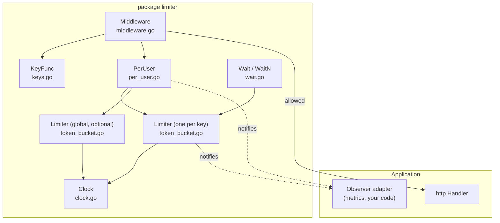
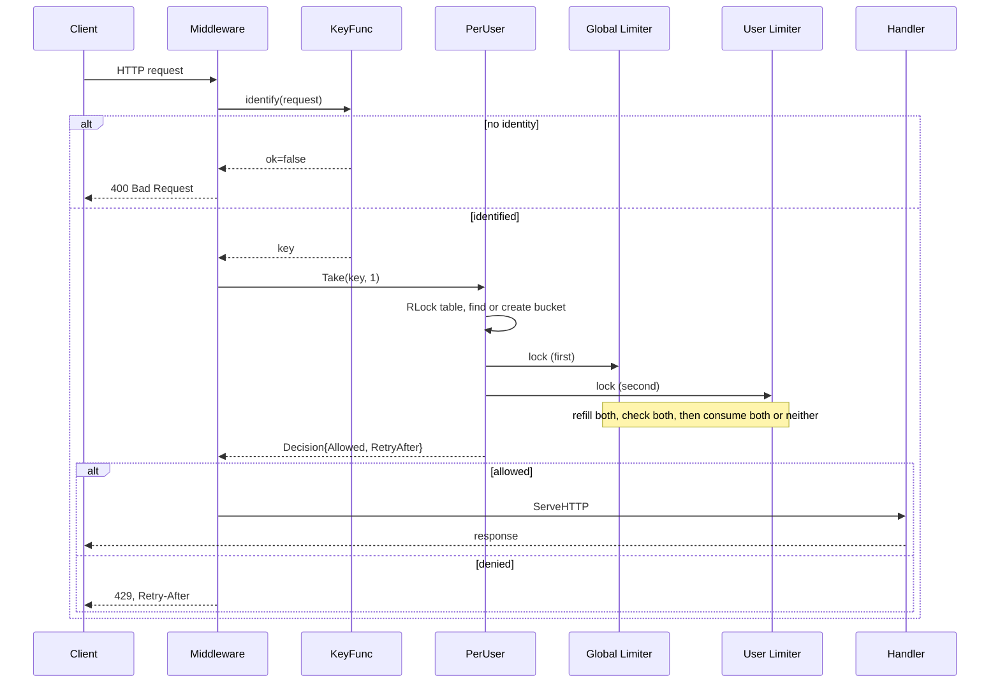
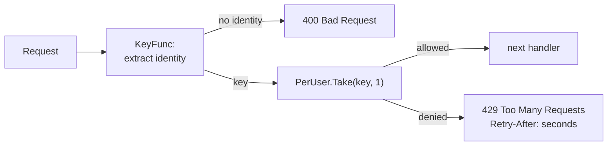

# Architecture

## 1. Components



| Piece                       | Responsibility                                                         | Does not do                        |
| --------------------------- | ---------------------------------------------------------------------- | ---------------------------------- |
| `Limiter`                   | One bucket. Lazy refill, atomic take, `Wait`.                          | Know about users or HTTP.          |
| `PerUser`                   | Key to bucket map, optional global charge, lifecycle of per-key state. | Decide identity, start goroutines. |
| `Middleware` and `KeyFunc`s | Translate HTTP requests to keys and decisions to 429 responses.        | Hold limiter state.                |
| `Observer`                  | Receive outcomes.                                                      | Receive keys (cardinality).        |
| `Clock`                     | Supply `Now()`.                                                        | Control sleeping.                  |

## 2. Request flow



1. The middleware asks the `KeyFunc` who the caller is.
2. `PerUser.Take` validates `n` (requests that can never succeed never touch the table).
3. It finds the caller's bucket under the table read lock, creating it under the write lock if missing (fails closed if `MaxUsers` is reached).
4. With a global limiter configured, both mutexes are locked in a fixed order.
5. Each bucket is refilled from its own elapsed time.
6. If both can cover the request, both are debited; otherwise neither is.
7. Locks are released, the observer is notified, and the decision returns.

## 3. Data structures

```go
type Limiter struct {
    rate, capacity float64   // immutable
    clock          Clock     // immutable
    observer       Observer  // immutable
    mu             sync.Mutex
    tokens         float64   // 0 <= tokens <= capacity
    last           time.Time // last refill
}

type PerUser struct {
    limit    Config
    global   *Limiter
    max      int
    mu       sync.RWMutex
    buckets  map[string]*Limiter
    lastSweep time.Time
}
```

Memory per tracked key is one `Limiter` (about 100 bytes), the key string, and map overhead. Measure it for your key sizes rather than trusting an estimate: `runtime.MemStats` before and after filling a table is enough.

## 4. Synchronization model

| Shared state                     | Protected by           | Held for                                           |
| -------------------------------- | ---------------------- | -------------------------------------------------- |
| `Limiter.tokens`, `Limiter.last` | `Limiter.mu`           | one refill/check/consume                           |
| `PerUser.buckets`, `lastSweep`   | `PerUser.mu` (RWMutex) | lookup plus charge (read); insert or sweep (write) |
| Immutable fields                 | nothing                | never change after construction                    |

Lock order: table, then global limiter, then user limiter. Details and the deadlock argument are in [concurrency.md](concurrency.md).

## 5. Per-user lookup and cleanup

### The problem

With millions of distinct keys the table is the dominant memory cost, and keys are attacker-influenced (API key headers, IP addresses). An unbounded map is a denial-of-service vulnerability: memory grows for as long as the attacker can invent identities.

### Cleanup: a bucket that is full is a bucket that does not exist

Consider a user whose bucket has refilled to capacity. A brand-new bucket for that user would be full too. The two are indistinguishable to every future request, so the stored one can be deleted with no effect on behavior.

`Cleanup` deletes exactly the buckets that are full (after applying pending refill). This is _lossless_: it can never grant a user tokens they had spent. A fixed idle timeout (for example "drop keys unseen for 10 minutes") is not lossless: with `rate = 1/hour` and `capacity = 10`, a user who spent everything 10 minutes ago would receive a fresh full bucket. `TestPerUser_CleanupIsLossless` runs the same random workload against a limiter that is swept aggressively and one that is never swept and requires identical decisions, with a global limiter involved.

Retention time follows from the parameters: a key is kept for at most `capacity / rate` seconds after its last use (time to refill from empty). For `capacity = 100`, `rate = 10` that is ten seconds. Slow rates with large capacities retain keys for a long time, which is unavoidable: the state is real.

### Lifecycle

`PerUser` starts no goroutine. The owner chooses:

```go
// Owned by the caller, stopped by the context.
go func() { _ = users.RunCleanup(ctx, time.Minute) }()

// Or call Cleanup from a loop you already have.
users.Cleanup()
```

A library that spawns an unstoppable goroutine in a constructor cannot be shut down, leaks in tests, and hides its cost. Here the goroutine, its interval and its termination are visible at the call site.

### Bounding memory: `MaxUsers`

Lossless cleanup bounds memory by "distinct keys seen within `capacity/rate`", which an attacker can still inflate. `MaxUsers` adds a hard cap. When full, the table is swept (at most once per second, so an attacker cannot force an O(n) scan on every request); if that frees nothing, requests for _new_ keys are rejected, while existing keys continue to work.

The trade-off, stated plainly:

- **Chosen: reject new keys when full.** Fails closed. Memory is bounded. Existing users are unaffected. A key-flooding attacker can prevent _new_ legitimate users from being admitted until buckets refill, so `MaxUsers` should be far above the legitimate working set and an alert on `Len()` near the cap is advisable.
- **Rejected: evict an arbitrary or least recently used key.** Eviction resets that user's budget (they get a fresh full bucket). An attacker rotating through keys could use eviction to erase other users' limits, or to reset their own.

### Other designs

| Design         | Idea                                    | Why not the default                                                                                                                                    |
| -------------- | --------------------------------------- | ------------------------------------------------------------------------------------------------------------------------------------------------------ |
| TTL eviction   | drop keys idle longer than a fixed time | lossy unless TTL >= `capacity/rate`; needs a `lastSeen` per key; adds tuning knob                                                                      |
| LRU            | bounded map ordered by recency          | O(1) with a list, but every hit mutates the list, forcing an exclusive lock on the hot path; eviction resets budgets                                   |
| Sharded table  | K maps, K locks                         | reduces contention and sweep pause; more code. The natural next step if profiling shows table contention or long sweeps                                |
| External store | Redis with key expiry                   | solves memory and cross-instance scope together, at a network round trip per request. See [distributed-rate-limiting.md](distributed-rate-limiting.md) |

The sweep holds the table's write lock while it scans, so its pause grows with the number of keys. For very large tables this is the reason to shard.

## 6. Global plus per-user limiting

A request must satisfy both layers. The naive composition is a bug:

```go
if global.Allow() && user.Allow() { ... }
```

If `global.Allow()` succeeds and `user.Allow()` fails, a global token was spent on a request that was rejected. One abusive user sending 10,000 requests per second, all rejected by their own limit, drains the global budget and starves everyone else. The rejected traffic should be free for the layer that would have admitted it.

The options:

| Option                                      | Behavior                                   | Problem                                                                                                                                                                    |
| ------------------------------------------- | ------------------------------------------ | -------------------------------------------------------------------------------------------------------------------------------------------------------------------------- |
| global then user                            | global debited before user checked         | abuser's rejected requests drain the global budget                                                                                                                         |
| user then global                            | user debited before global checked         | when the global bucket is empty every user's bucket is drained by requests that were rejected anyway; users emerge from an outage with less budget than they should        |
| debit then refund                           | take from first, return it if second fails | a window in which the first bucket is temporarily too low, causing spurious rejections for concurrent requests; refund must clamp to capacity; more states to reason about |
| **check both, then debit both, atomically** | hold both locks, decide, then change       | none on correctness; cost is that the global mutex is held slightly longer, and lock ordering must be respected                                                            |

The implementation is `takeTwo`. `TestPerUser_NoTokenLeakageBetweenLayers` proves both directions (100 abusive requests leave the global bucket at exactly 8 of 10; globally rejected requests leave the user's bucket untouched), and `TestPerUser_ConcurrentGlobalAndUserAccounting` checks under concurrency that the tokens spent by all users equal the tokens spent by the global bucket, exactly.

The retry hint for a rejection is the larger of the two layers' waits, since the request needs both.

## 7. HTTP middleware



`Retry-After` holds whole seconds rounded up, so a client that obeys it does not retry early. It is omitted when the limiter has no estimate (the table is full and the key is new). It is a hint, not a promise: another request may consume the token first, and the header gives no fairness guarantee. It is appropriate on 429 (and 503) responses to cooperative clients; it does not stop a client that ignores it.

The middleware returns 400 when no identity can be determined. A service that prefers a coarser fallback composes key functions with `FirstKey`.

## 8. Client identity

| Strategy              | `KeyFunc`             | Strengths                                                           | Weaknesses                                                                                                                   |
| --------------------- | --------------------- | ------------------------------------------------------------------- | ---------------------------------------------------------------------------------------------------------------------------- |
| Authenticated user ID | `KeyFromContextValue` | accurate per-person limits; cannot be rotated without a new account | requires authentication to run first                                                                                         |
| API key               | `KeyFromHeader`       | accurate per-integration limits                                     | the key must be validated before limiting, or clients can mint identities (and memory) at will; keys can be shared or leaked |
| Peer IP               | `KeyFromRemoteAddr`   | needs no credentials; cannot be spoofed at TCP level                | see below                                                                                                                    |
| Forwarded IP          | `KeyFromForwardedFor` | recovers the client behind your own proxies                         | spoofable unless configured exactly right                                                                                    |

Combine them with `FirstKey`: authenticated user, then API key, then IP. Namespace prefixes (`user:`, `key:`, `ip:`) keep the different kinds of identity from colliding.

**Why IP limiting is problematic.**

- _NAT and carrier-grade NAT_: thousands of mobile subscribers can share one public address; one noisy user gets everybody rate limited.
- _Corporate networks and universities_: an entire organization egresses through a few addresses.
- _Proxies and VPNs_: users share exit nodes; a single user can rotate through many.
- _IPv6_: a single subscriber is typically assigned a /64 containing 2^64 addresses. Limiting per address is meaningless; `KeyFromRemoteAddr` therefore truncates IPv6 to /64 (and unmaps IPv4-in-IPv6).
- _Shared infrastructure_: cloud functions, crawlers and monitoring services concentrate many users behind few addresses.

IP limits are a coarse first line of defense, best applied generously and in addition to, not instead of, authenticated limits.

**`X-Forwarded-For` is client-controlled.** Any client can send `X-Forwarded-For: 1.2.3.4`. Proxies append their view of the peer address to the right of whatever the client supplied, so the left side is forgeable and only the entries added by proxies _you operate_ can be trusted. `KeyFromForwardedFor(n)` therefore selects the entry `n` positions from the right, where `n` is the number of your own proxies in front of the service, and returns no identity when there are fewer entries (a request that bypassed the proxy). If `n` is wrong, or the service is reachable without going through the proxy, the function is bypassable, which is why it is opt-in, documented, and never the default. It also never reads `X-Real-IP`, `Forwarded`, or other headers, which carry the same trust questions.

Keys from request data are capped at 256 bytes so a client cannot spend server memory at the size of its headers.

## 9. Error paths

| Situation                                             | Behavior                                                                                        | Where                       |
| ----------------------------------------------------- | ----------------------------------------------------------------------------------------------- | --------------------------- |
| Invalid `Rate` or `Capacity` (<= 0, < 1, NaN, Inf)    | `NewLimiter` returns an error wrapping `ErrInvalidConfig`; no limiter is created                | construction                |
| Negative `MaxUsers`, non-positive cleanup interval    | error wrapping `ErrInvalidConfig`                                                               | construction / `RunCleanup` |
| `AllowN(n)` with `n < 1` or `n > capacity`            | returns false, consumes nothing, creates no per-user state, sends no observer event for `n < 1` | call time                   |
| `WaitN` with `n < 1` / `n > capacity`                 | `ErrInvalidTokens` / `ErrExceedsCapacity`                                                       | call time                   |
| `Wait` with cancelled context                         | returns `ctx.Err()`, consumes nothing                                                           | call time                   |
| `Wait` whose required delay exceeds the deadline      | returns immediately with an error wrapping `context.DeadlineExceeded`                           | call time                   |
| Clock moves backwards                                 | no tokens credited; time re-anchored                                                            | request                     |
| `PerUser` table full, new key                         | rejected with no `RetryAfter`; middleware sends 429 without `Retry-After`                       | request                     |
| No identity on an HTTP request                        | 400, no state created                                                                           | middleware                  |
| `nil` arguments to `Middleware`, `trustedProxies < 1` | panic at wiring time                                                                            | startup                     |

Errors are plain `error` values with wrapped sentinels (`errors.Is`). There is no error hierarchy; callers have at most three conditions to distinguish.

## 10. Architecture decisions

### Decision 1: one mutex per bucket

- **Why**: refill, check and consume must be atomic with respect to each other; a mutex makes that obvious, the critical section is tiny, and two-bucket atomic takes stay simple.
- **Alternatives**: atomics with packed state (GCRA, CAS loop); sharded buckets; channels.
- **Trade-offs**: simplicity and correctness over peak throughput on a single hot bucket. Contention is discussed in [concurrency.md](concurrency.md), with upgrade paths.

### Decision 2: `float64` tokens

- **Why**: fractional refill is the natural model; fractional rates; readable.
- **Alternatives**: integer tokens, fixed-point nanotokens, GCRA.
- **Trade-offs**: small conservative rounding error in exchange for clarity. Details in [token-bucket.md](token-bucket.md).

### Decision 3: lazy refill, no background goroutine

- **Why**: O(1) per request, nothing to leak, nothing to shut down, deterministic under a fake clock.
- **Alternatives**: ticker per bucket; shared sweeper.
- **Trade-offs**: state is only as fresh as the last call (`Tokens()` computes on demand); the time to read the clock is paid inside the critical section.

### Decision 4: `Clock` interface with only `Now()`

- **Why**: a fake clock makes refill tests instant and exact, and the bucket needs nothing else.
- **Alternatives**: `time.Now` only (tests must sleep or are inexact); a richer clock with timers (lets `Wait` be tested with virtual time).
- **Trade-offs**: `Wait` sleeps with real timers, so it is tested with real, short durations. A timer-capable clock is a reasonable extension but doubles the abstraction.

### Decision 5: atomic two-bucket take

- **Why**: rejected requests must not leak tokens from the other layer.
- **Alternatives**: ordering, refund (section 6).
- **Trade-offs**: both mutexes held together, so lock order is a rule every future change must follow.

### Decision 6: lossless cleanup by fullness, run by the caller

- **Why**: eviction never changes a decision; the lifecycle is visible.
- **Alternatives**: TTL, LRU, background goroutine inside the constructor.
- **Trade-offs**: retention is `capacity/rate`, which may be long; the sweep pauses the table proportionally to its size; the caller must remember to run it (documented on `PerUser`, shown in the examples).

### Decision 7: reject new keys at `MaxUsers`

- **Why**: bounded memory; eviction would reset budgets.
- **Alternatives**: evict LRU; fail open.
- **Trade-offs**: key flooding can lock out new users until buckets refill.

### Decision 8: `Wait` retries instead of reserving

- **Why**: keeps `0 <= tokens`; no refund path on cancellation; no goroutines.
- **Alternatives**: reservations with negative balance (as in `golang.org/x/time/rate`); a FIFO waiter queue.
- **Trade-offs**: no ordering guarantee among waiters; possible starvation under overload.

### Decision 9: `Observer` interface without keys

- **Why**: lets any metrics system be attached without a dependency; cannot be misused to create per-user labels.
- **Alternatives**: built-in Prometheus metrics; callbacks with the key.
- **Trade-offs**: per-key diagnostics need logging instead ([observability.md](observability.md)).

### Decision 10: standard library only; middleware in the same package

- **Why**: no dependencies to audit or version; `net/http` is part of the standard library. A separate middleware module would double the packages for a few dozen lines.
- **Alternatives**: separate `httpmiddleware` package; framework-specific adapters.
- **Trade-offs**: the core package imports `net/http`, which is acceptable for a standard-library-only package but would move out if other transports (gRPC) were added.

### Repository layout

There is no `cmd/` or `internal/` directory. The project is a library with runnable examples under `examples/`, and there is nothing private worth hiding: every exported symbol is intentional. Directories were not added for appearance.
