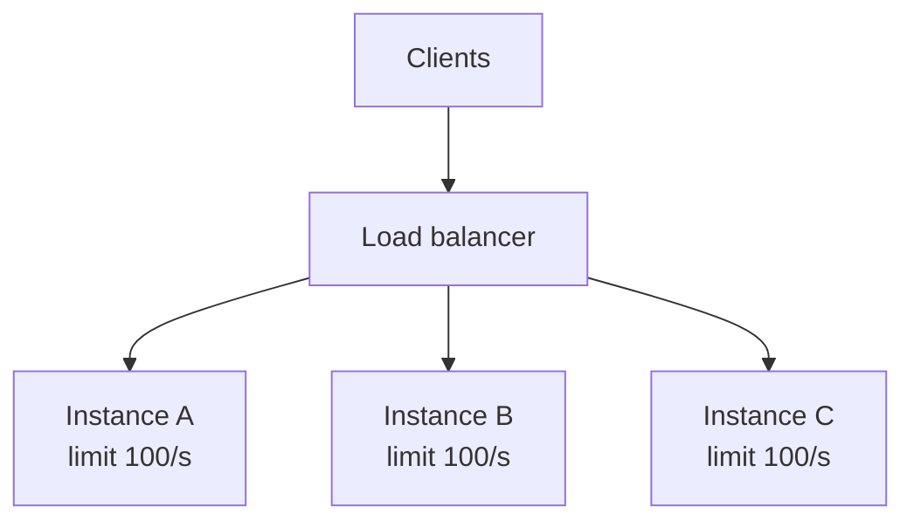

# Distributed Rate Limiting

This repository's limiter is **in-process**. Its state lives in one process's memory, and its guarantees hold only within that process. This document explains where that stops being enough and what to do about it. Nothing here is implemented in the repository except the local pieces; the Redis sketch is illustrative and has not been executed.

## 1. Why local limiting breaks down



Each instance enforces "100 requests per second per user" using its own buckets. What does the *user* experience?

- If the load balancer sends all of a user's requests to one instance (sticky routing), the limit is 100/s.
- If it spreads them evenly, each instance sees a third of the traffic and admits all of it up to 100/s each: the user gets up to **300/s**.
- If the number of instances changes (autoscaling, deploys), the effective limit changes with it.

So the effective limit is somewhere between `limit` and `N x limit`, depending on routing, which the limiter does not control and cannot observe. The same multiplication applies to burst capacity: a user can spend `C` tokens on each instance.

Related local-only effects:

- **Restart resets state.** A fresh process has full buckets everywhere, so a rolling deploy hands every user a new burst on each instance.
- **No shared view.** One instance cannot know another has already refused a user.
- **Scaling the limit down.** A common workaround is configuring each instance with `limit / N`. It is cheap and often acceptable, but wrong whenever traffic is uneven (one instance rejects a user while others sit idle) or N changes.

Whether any of this matters depends on what the limit protects. If it is a soft fairness limit, a 3x error may be fine. If it protects a hard downstream capacity or enforces a paid quota, it is not.

## 2. Options

### 2.1 Centralized state (for example Redis)

Every instance asks a shared store whether the request is allowed. The bucket lives in the store, keyed by user. One state, one answer, regardless of which instance handles the request.

**Atomicity is the central problem.** Read-modify-write from several instances is the same check-then-act race described in [concurrency.md](concurrency.md), now across machines: two instances read `tokens = 1`, both decrement. The decision must execute atomically inside the store. In Redis that means either a single atomic command (`INCR` for fixed windows) or a **Lua script**: Redis runs a script to completion without interleaving other commands, so refill, check, and consume become one operation.

Illustrative sketch (not tested here; verify against your Redis version's scripting and replication semantics):

```lua
-- KEYS[1]  bucket key, e.g. "rl:user:123"
-- ARGV[1]  rate (tokens/s)   ARGV[2] capacity   ARGV[3] n   ARGV[4] ttl in ms
local t = redis.call('TIME')                       -- use the server's clock, not the client's
local now_ms = t[1] * 1000 + math.floor(t[2] / 1000)

local s = redis.call('HMGET', KEYS[1], 'tokens', 'ts')
local rate, cap, n = tonumber(ARGV[1]), tonumber(ARGV[2]), tonumber(ARGV[3])
local tokens, ts = tonumber(s[1]), tonumber(s[2])
if tokens == nil then tokens, ts = cap, now_ms end  -- missing key = full bucket

tokens = math.min(cap, tokens + math.max(0, now_ms - ts) * rate / 1000)  -- lazy refill
local allowed, retry_ms = 0, 0
if tokens >= n then
  tokens = tokens - n
  allowed = 1
else
  retry_ms = math.ceil((n - tokens) / rate * 1000)
end
redis.call('HSET', KEYS[1], 'tokens', tokens, 'ts', now_ms)
redis.call('PEXPIRE', KEYS[1], ARGV[4])            -- expire idle buckets
return { allowed, retry_ms }
```

It is the same algorithm as `Limiter`, with the same lazy refill. Two points carry over directly from this repository: using one authoritative clock (the store's) removes cross-machine clock skew, and setting the key expiry to at least the time to refill from empty (`capacity / rate`) gives the same *lossless* cleanup property as `PerUser.Cleanup`, because an expired key behaves as a full bucket.

Costs:

- **Latency.** Every decision adds a network round trip to the request path, plus the store's processing time. The local limiter's decision is a function call.
- **Availability.** The store becomes a dependency of every request (see section 3).
- **Throughput.** A single hot key (one very active user, or a global limiter) is serialized on one shard. Redis Cluster shards by key, which spreads different users but not one hot user.
- **Memory.** Keys are still per user; expiry handles idle ones.

### 2.2 Hybrid: local fast path, central reconciliation

Each instance keeps a local bucket and periodically leases tokens from, or reports usage to, the central store. Fewer round trips, lower latency, better availability; the price is accuracy. Tokens leased to an instance that then receives no traffic are stranded; a user can overshoot by up to the outstanding leases. A practical option when a few percent of error is acceptable and the latency of a per-request round trip is not.

### 2.3 Enforce at the edge

An API gateway, reverse proxy or service mesh sidecar sees all traffic for a route before it fans out to instances, so its local view is closer to the global one. Examples of where to look: NGINX's `limit_req`, Envoy's local and global rate limit filters (global mode calls a separate rate limit service), API gateways' built-in quotas.

- *Pros*: no application code; uniform policy across services; can shed load before it reaches the application.
- *Cons*: limits keyed on application-level identity require the gateway to understand it; gateway instances are themselves horizontally scaled, so the same N-instance problem can reappear one layer up; configuration lives outside the codebase.

### 2.4 Dedicated rate limit service

A separate service owns the buckets and exposes `Allow(key, n)` over gRPC or HTTP, typically backed by Redis or sharded in memory. It centralizes policy, auditing and metrics, at the cost of an extra network hop and an extra thing to operate and scale.

### Comparison

| Approach | Accuracy | Added latency | Availability dependency | Operational cost |
|---|---|---|---|---|
| Local only | within `[limit, N x limit]` | none | none | none |
| Local with `limit / N` | uneven-traffic error; breaks when N changes | none | none | low, but N must be tracked |
| Central store, per request | exact (subject to store consistency) | one round trip | the store | moderate |
| Hybrid leases | approximate | rare round trips | degraded gracefully | moderate to high |
| Gateway or mesh | good for edge-visible identity | small, in path | the gateway | low to moderate |

## 3. Consistency, latency, availability

The central store forces the classic trade-off.

- **Consistency vs latency.** A strictly consistent answer needs one authoritative copy touched on each request. Every relaxation (leases, async counters, per-region state) buys latency and availability by accepting bounded over-admission.
- **Replication.** If the store has replicas and fails over, a replica may be missing the most recent updates, so users briefly receive budget they had spent. Usually acceptable for rate limiting; not for billing-grade quotas.
- **Hot keys.** Global limits and very active tenants concentrate load on one key. Split the key into sub-buckets (sharded limit), or accept approximation for that key.
- **Multi-region.** Cross-region round trips are expensive. Common choices are a limit per region (a fraction of the global limit, possibly rebalanced slowly), or global reconciliation with eventual consistency and bounded overshoot. A strictly global limit across regions implies paying inter-region latency on the request path.

## 4. Failure modes: fail open or fail closed

When the shared store is unreachable, the limiter must decide.

| Policy | Behavior | Good when | Risk |
|---|---|---|---|
| **Fail open** | allow requests | the limiter protects fairness or cost, and an outage of the limiter must not become an outage of the product | the protected resource is unprotected exactly when something is wrong; an attacker can target the limiter's dependency to lift the limit |
| **Fail closed** | reject requests | the limit protects something fragile or security-critical (login attempts, expensive downstream) | the limiter's dependency becomes a single point of failure for the whole service |
| **Degrade to local** | fall back to an in-process limiter, possibly at `limit / N` | most services | accuracy drops to the local-only case (section 1), but both extremes are avoided |

There is no universally correct choice. It depends on what the limit protects and on the threat model: a login endpoint protecting against password guessing argues for closed or degraded-local; a public read API protecting against accidental overload usually argues for open or degraded-local. Whichever is chosen should be explicit, configured, tested, and covered by an alert, and the lookup should carry a **short timeout** so that a slow store does not turn every request slow.

This repository's in-process limiter has no such dependency: its failure mode is process loss, which resets state to full buckets.

## 5. Recommendations

1. Start local. It is correct, fast and free of dependencies, and is the right answer for single-instance services and for protecting a single process's own resources.
2. Put a local limiter *in front of* any distributed one regardless: it is an inexpensive first filter that protects the store from abuse and keeps working when the store does not.
3. Move to a shared store when the limit is a hard contract (paid quotas, downstream capacity) and instances are many enough that the `N x` error matters.
4. Decide fail-open, fail-closed or degrade-to-local before the first outage, not during it.
